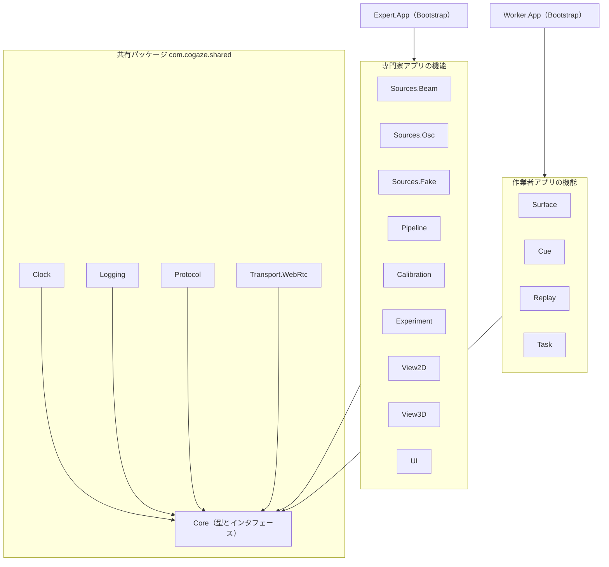

# CoGaze2 Unity実装詳細

Oct 7, 2026 · @Takuma

## この文書の位置づけ

SRSが「何をするか」を決め、この文書は「Unityでどう組むか」を決める。要求のIDはSRSのものをそのまま参照し、ここでは新しい要求を作らない。

対象は専門家側Unity（EXP）と作業者側Unity（WRK）の2つ。Pythonの記録プロセス、Beam、Tobiiブリッジ、GPUサーバは、Unityとの境目（受け取るデータの形）だけを扱う。

前提として、通信にFusionは使わず、実験中の視線推定はBeamを使う。2D映像の経路は必須で、3D再構成の経路は同じアプリの中で試す。

## 設計の方針

4つの品質は、次のルールに置き換えて守る。ルールはどれも、コードを見れば守れているか確かめられる形にしてある。

| 品質 | ルール | 確かめ方 |
|---|---|---|
| 編集しやすさ | 実験の条件と数値はJSONに置き、ビルドし直さずに変えられる | 条件を変えるときにC#を触っていないか |
| 読みやすさ | 1フォルダ＝1アセンブリ＝1つの役割。1ファイル1クラス、300行を超えたら分ける | フォルダ名だけで役割が分かるか |
| 疎結合 | 機能どうしは直接呼ばず、Coreに置いたインタフェースとデータ型だけで話す。組み立ては起動時の1か所（Bootstrap）だけ | asmdefの参照がCore以外に向いていないか |
| 実験を回せる品質 | カメラ、Beam、Questがなくても、偽物の部品で全体を通しで動かせる。異常は黙って直さず、画面と記録に出す | リハーサルモードで1セッション最後まで走るか |

シングルトン、`FindObjectOfType`、staticな状態は使わない。どこから呼ばれているかが追えなくなるためである。

## 全体の分割

専門家アプリと作業者アプリは別々のUnityプロジェクトにし、両方が使う部分だけを共有パッケージに出す。中心は`CoGaze.Core`で、すべての機能はここだけを参照する。



矢印は「参照してよい」向きである。機能の箱どうしの間には矢印がない。たとえば`Pipeline`は`Sources.Beam`を知らず、`IGazeSource`という形だけを知っている。具体的な部品を選んでつなぐのは、一番上のBootstrapだけである。

## 各モジュールの責務

アセンブリ（asmdef）は次の20個に分ける。依存してよい先を表の右端に書き、それ以外への参照はasmdefで禁止する。

| アセンブリ | 置き場所 | 役割 | 依存してよい先 |
|---|---|---|---|
| `CoGaze.Core` | 共有 | データ型とインタフェースだけ。MonoBehaviourを持たない | なし |
| `CoGaze.Clock` | 共有 | QPCをns整数で返す`IClock`の実装 | Core |
| `CoGaze.Logging` | 共有 | CSVを別スレッドで書く`ILogSink`の実装 | Core |
| `CoGaze.Protocol` | 共有 | GazeCueと制御メッセージの直列化 | Core |
| `CoGaze.Transport.WebRtc` | 共有 | 映像・音声・データチャネル。`ICueSender`/`ICueReceiver`の実装 | Core, Protocol |
| `Expert.Sources.Beam` | 専門家 | Beam SDKを`IGazeSource`に包む | Core |
| `Expert.Sources.Osc` | 専門家 | Tobiiブリッジと記録プロセスのOSCを受ける | Core |
| `Expert.Sources.Fake` | 専門家 | 決まった軌跡を出す偽の視線（リハーサル用） | Core |
| `Expert.Pipeline` | 専門家 | 視線ソースの切り替え、フィルタ、`sigma`の決定 | Core |
| `Expert.Calibration` | 専門家 | キャリブレーションと検証点の表示、誤差の記録 | Core |
| `Expert.View2D` | 専門家 | 2D映像を映し、注視点を視線レイに変える | Core |
| `Expert.View3D` | 専門家 | メッシュを映し、注視点を視線レイに変える | Core |
| `Expert.Experiment` | 専門家 | 条件の読み込み、試行の進行 | Core |
| `Expert.UI` | 専門家 | チェックリスト画面と実験者の操作 | Core |
| `Expert.App` | 専門家 | Bootstrap。部品を選んでつなぐだけ | すべて |
| `Worker.Surface` | 作業者 | QRで作業面を合わせて固定する | Core |
| `Worker.Cue` | 作業者 | GazeCueを作業面に当て、Ray/Circle/Frustumで描く | Core |
| `Worker.Replay` | 作業者 | 記録した視線を`ICueReceiver`として流す | Core |
| `Worker.Task` | 作業者 | 課題の配置、選択の確定、記録 | Core |
| `Worker.App` | 作業者 | Bootstrap | すべて |

機能どうしが話すときに使うのは、Coreに置く次のインタフェースだけである。

```csharp
namespace CoGaze.Core
{
    public interface IClock { long NowNs { get; } }

    // 視線の入り口。Beam、Tobii、偽物、どれも同じ形で出す
    public interface IGazeSource
    {
        string Name { get; }              // "beam", "tobii", "fake"
        bool TryRead(out GazeSample s);   // 新しい値がなければfalse
    }

    // 画面上の注視点を作業空間の視線レイに変える。2Dと3Dで別実装
    public interface IGazeRayProjector
    {
        bool TryProject(in GazeSample s, out GazeRay ray);
    }

    // sigmaの決め方。fixed / calib / calib_live で別実装
    public interface ISigmaPolicy
    {
        float SigmaDeg(in GazeSample s, in GazeRay ray);
    }

    public interface ICueSender { void Send(in GazeCue cue); }
    public interface ICueReceiver { bool TryReceive(out GazeCue cue); }

    public interface ILogSink { void Write(string table, string row); }
}
```

データ型（`GazeSample`、`GazeRay`、`GazeCue`、`Condition`）は書き換えられない`readonly struct`にする。途中で値が変わらないので、どこで何が起きたかを記録から追える。

## 視線の流れ

1フレームの処理は、専門家側も作業者側も、純粋なC#のクラス1つ（`GazePipeline`、`CuePipeline`）に順番どおり書く。MonoBehaviourは毎フレームそれを呼ぶだけにする。順番が1か所で読めて、Unityを起動せずにテストできる。

**専門家側（`GazePipeline.Tick`）**

1. すべての`IGazeSource`から値を読み、受け取ったものは全部`display.csv`に書く（EXP-F-032）
2. 視線ソースの切り替え：条件の`display_source`と同じ名前のソースだけを残す。`none`ならここで終わる（EXP-F-030, 031）
3. フィルタ：前後の値を両方記録する（EXP-F-040）
4. `IGazeRayProjector`で視線レイにする。2Dか3Dかはここで差し替わるだけで、前後の処理は変わらない
5. `ISigmaPolicy`で`sigma`を決める。`show_uncertainty`がoffでも`sigma`は計算して記録する（EXP-F-047, 049）
6. 送信の頻度を超えていなければGazeCueを送り、送ったソースと`sigma`を記録する（EXP-F-033, 043）

**作業者側（`CuePipeline.Tick`）**

1. `ICueReceiver`から受け取る。ライブでも再生でも同じ入口
2. 固定した作業面に視線レイを当てて交点を出す
3. 条件の`visualization`で描き方を選ぶ。`show_uncertainty`がonなら`sigma`で大きさを決め、offなら既定の大きさで描く
4. 交点、`sigma`、描いた大きさを`cue.csv`に書く

描き方（Ray / Circle / Frustum）は`ICueRenderer`の3つの実装にして、条件で1つを選ぶ。新しい描き方を足すときは実装を1つ増やすだけで済む。

## 設定と条件

設定は2つのJSONに分け、実行ファイルの隣の`config/`に置く。テキストエディタで直せば、ビルドし直さずに反映される。

| ファイル | 中身 | 変える人 |
|---|---|---|
| `app.json` | IPアドレス、ポート、カメラ、送信頻度、フィルタの既定値、2D/3Dの選択 | 開発者 |
| `conditions.json` | 条件の一覧と、参加者ごとの順番 | 実験者 |

条件は1つにつき1つのオブジェクトで書く。

```json
{
  "condition_id": "C04",
  "display_source": "beam",
  "visualization": "circle",
  "show_uncertainty": true,
  "sigma_source": "calib",
  "fixed_sigma": 3.0,
  "filter": "default",
  "task": "identify_A"
}
```

読み込むときに中身を検査し、おかしければ起動を止めて、チェックリスト画面に理由を出す。たとえば`display_source`が知らない名前、`sigma_source`が`fixed`なのに`fixed_sigma`がない、同じ`condition_id`が2つある、といった場合である。黙って既定値で動かすことはしない。

条件の切り替えは`TrialRunner`という状態機械だけが行う。状態は「待機 → 準備完了 → 試行中 → 試行間」の4つで、条件が変わるのは「試行間 → 準備完了」のときだけである（EXP-F-034）。他のモジュールは、今の条件を読むことはできても書き換えることはできない。

新しい条件は作業者側にも送り、作業者側から同じ`condition_id`が返ってくるまで試行を始めない。両側で条件が食い違ったまま試行が始まることを防ぐためである。

## 記録

記録は`ILogSink`1つを通して書き、メインスレッドでは行を列に積むだけにする。ファイルへの書き込みは別スレッドが行うので、ディスクが遅くても描画は止まらない。

- **時刻**：すべての行の先頭に`IClock.NowNs`を入れる。`Time.time`や`DateTime.Now`は記録に使わない
- **書き出し**：1秒ごとと試行の終わりにflushする。アプリが落ちても、失うのは最後の1秒以内にとどまる
- **列の形**：各CSVの列名はCoreに定数として1か所に置き、書く側と読む側（分析スクリプト）で同じものを使う
- **セッションフォルダ**：開始時に作り、`app.json`と`conditions.json`の写し、アプリのバージョン、gitのコミットIDを最初に保存する。後から「どの設定で取ったデータか」を必ずたどれる
- **詰まりの検知**：列に溜まった行数をチェックリスト画面に出し、しきい値を超えたら赤にする

## 実験を回せる品質

本番の前に、機材なしで1セッションを最後まで通せることを品質の基準にする。そのために3つの仕組みを入れる。

**リハーサルモード**

`app.json`の切り替え1つで、すべての外部の部品を偽物に差し替える。差し替えはBootstrapの中だけで行い、他のコードは本番と同じものが動く。

| 本物 | 偽物 |
|---|---|
| Beam | `FakeGazeSource`：画面上を決まった軌跡で動く注視点 |
| Tobii（OSC） | `FakeGazeSource`：Beamの軌跡に決まったずれを足したもの |
| WebRTCの相手 | `LoopbackTransport`：同じPC内で送ったものをそのまま返す |
| Quest | 作業者アプリをPCのエディタで動かす |

**失敗の見せ方**

異常が起きたら、黙って直さずに、チェックリスト画面の赤い行と`events.csv`の両方に出す。赤い行には、何が起きたかと、実験者が次にすることを1文ずつ書く（例：「Beamから値が来ていません。Beamのウィンドウで入力カメラを確認してください」）。試行中に赤が出たら、その試行に印を付け、後から分析で除外できるようにする。

**再開**

アプリが落ちても、同じ参加者IDで起動し直せば、最後に終わった試行の次から続けられるようにする。`TrialRunner`の状態はセッションフォルダの`progress.json`に試行ごとに書いておく。

## テスト

視線の処理はMonoBehaviourから切り離してあるので、ほとんどをUnityのEditModeテスト（起動不要、数秒で終わる）で確かめられる。PlayModeテストは通しの動作確認だけに使う。

| テスト | 種類 | 確かめること | SRS |
|---|---|---|---|
| 切り替えの単一経路 | EditMode | 偽のソースを3つ流し、送られるのが`display_source`の1つだけか | VT-01, EXP-F-030 |
| 視線なし条件 | EditMode | `none`のとき、GazeCueが1つも送られないか | EXP-F-031 |
| sigmaの決め方 | EditMode | `fixed`、`calib`、`calib_live`がそれぞれ期待どおりの値を返すか | EXP-F-046 |
| 条件の検査 | EditMode | 壊れた`conditions.json`で起動が止まり、理由が出るか | なし |
| 2Dの変換 | EditMode | パネルの中央を見たとき、期待した視線レイになるか | なし |
| CSVの列 | EditMode | 書いたCSVの列名が、Coreの定数と一致するか | なし |
| 通しのリハーサル | PlayMode | 偽物の部品で3試行を回し、全ファイルができて行数が0でないか | なし |
| 条件の食い違い | PlayMode | 作業者側が違う`condition_id`を返したとき、試行が始まらないか | なし |

Claude Codeに実装を頼むときは、まずテストを書かせ、テストが通ることを完了の条件にする。

## フォルダ構成と命名

1つのリポジトリに、共有パッケージと2つのUnityプロジェクトを並べる。共有パッケージはローカルのUPMパッケージにして、両方のプロジェクトから参照する。同じコードを2か所にコピーしない。

```
CoGaze2/
  packages/com.cogaze.shared/
    Runtime/Core/ Clock/ Logging/ Protocol/ Transport.WebRtc/
    Tests/
  expert-app/Assets/CoGaze/Expert/
    Sources/Beam/ Sources/Osc/ Sources/Fake/
    Pipeline/ Calibration/ View2D/ View3D/
    Experiment/ UI/ App/
    Tests/
  worker-app/Assets/CoGaze/Worker/
    Surface/ Cue/ Replay/ Task/ App/
    Tests/
  python/          記録プロセス、Tobiiブリッジ
  config/          app.json と conditions.json の見本
```

BeamのSDKはリポジトリに入れない（公開リポジトリへの掲載が禁止されているため）。`Assets/ThirdParty/Beam/`に各自で置き、`.gitignore`で除外する。`Expert.Sources.Beam`のasmdefには`COGAZE_BEAM`の定義があるときだけコンパイルされる条件を付ける。SDKがない環境でも、プロジェクトは開けて、リハーサルモードで動く。

**命名**

- 名前空間はアセンブリ名と同じにする（例：`CoGaze.Expert.Pipeline`）
- 実装クラスは「何の」＋「役割」で名付ける（`BeamGazeSource`、`FixedSigmaPolicy`、`CircleCueRenderer`）
- MonoBehaviourには`Behaviour`を付け、ただのクラスと見分けられるようにする（`GazeTickerBehaviour`）
- 単位を持つ値は名前に単位を入れる（`SigmaDeg`、`TCaptureNs`、`DistanceMm`）

## 実装の順番とClaude Codeへの渡し方

土台から順に作り、どの段階でもリハーサルモードで通しが動く状態を保つ。2D経路を最後まで通してから、3D経路に入る。

1. `CoGaze.Core`、`Clock`、`Logging`：データ型、インタフェース、時刻、CSVの書き出し
2. `Expert.Sources.Fake`と`Expert.Pipeline`：偽の視線で、切り替え、フィルタ、`sigma`まで。VT-01のテストをここで通す
3. `Expert.Experiment`と`Expert.UI`：条件の読み込み、`TrialRunner`、チェックリスト画面
4. `Expert.Sources.Beam`と`Expert.Sources.Osc`：仮想カメラ経由でBeamが動くことを確かめてから
5. `Transport.WebRtc`、`Expert.View2D`、`Worker.Surface`、`Worker.Cue`：2D経路を作業者のQuestまで通す
6. `Expert.Calibration`：検証点と誤差の記録。これで`calib`の`sigma`が使えるようになる
7. `Worker.Replay`と`Worker.Task`
8. `Expert.View3D`：GPUサーバのメッシュを受けて、視線レイに変える

Claude Codeには、1回に1つのアセンブリを頼む。頼むときに渡すのは、対象のSRSの要求ID、この文書の該当する節、先に書くテストの3つである。

リポジトリの直下に`CLAUDE.md`を置き、毎回守るルールを書いておく。中身は「設計の方針」の表、asmdefの依存の向き、命名のルール、そして「Coreのインタフェースを変えるときは必ず先に相談すること」の4つで足りる。Coreは全員が依存するので、ここが勝手に変わると全体が崩れる。
