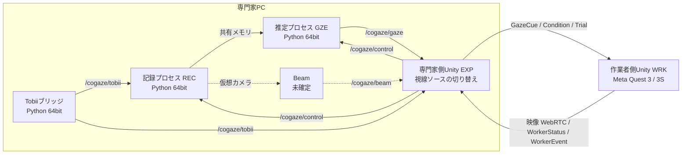

# CoGaze ソフトウェア要求仕様書（SRS）

Oct 2, 2026 · @Takuma

本書は、専門家のWebカメラ視線を作業者のMR視界に共有するシステムCoGazeの、作り直し版の要求を定める。構成はISO/IEC/IEEE 29148:2018のSRSに準拠し、実装はClaude Codeに委ねることを前提に、すべての要求にIDと検証方法を付ける。

## 1 はじめに

### 1.1 目的

本書は、CoGazeの作り直し版が満たすべき要求を定める。読者は、実装を担うClaude Code、開発者（増田）、指導教員である。実装は本書の要求ID単位で進め、完了は各要求の検証方法で判定する。

### 1.2 範囲

対象は次の4つのサブシステムである。

- 記録システム（REC）：専門家PCで、Webカメラ映像と比較用の視線を記録する
- 視線追跡（GZE）：専門家PCで、Webカメラ映像から視線を推定する
- 専門家側Unity（EXP）：専門家PCで、作業者の映像を表示し、キャリブレーション、視線ソースの切り替え、実験の進行を担う
- 作業者側Unity（WRK）：Meta Quest上で、作業空間に専門家の視線を表示し、映像を専門家へ送る

範囲外：推定器の学習、3次元再構成（CoGaze2）、統計解析のスクリプト。

### 1.3 用語

| 用語 | 意味 |
| --- | --- |
| 専門家 | PCの前で作業者に指示を出す参加者 |
| 作業者 | Meta Questを装着して物理的な作業を行う参加者 |
| 実験者 | 実験を運営する人。参加者ではない |
| 視線ソース | 視線データの出どころ。`webcam:<推定器名>`、`tobii`、`beam`、`replay`のいずれか |
| 表示ソース | 実験条件が指定する、作業者へ送る1つの視線ソース。視線なし条件では`none` |
| 推定器 | 顔画像から視線を推定する部品（MobileGaze、Gaze360など） |
| sigma | 推定の不確かさ。角度（度）で表す |
| フォールバック | 目の推定が崩れたときに、頭部方向へ切り替えること |
| 作業面 | QRマーカーで定義する、作業机の天板の平面 |
| セッション | 1組の参加者による1回の実験 |
| 試行 | セッション内の1回の課題 |
| QPC | WindowsのQueryPerformanceCounter。専門家PC内の共通時計 |
| OSC | Open Sound Control。UDP上のメッセージ形式 |

### 1.4 参照文書

- ISO/IEC/IEEE 29148:2018 Systems and software engineering, Life cycle processes, Requirements engineering
- CoGaze v1（[github.com/Fialuxe/CoGaze](https://github.com/Fialuxe/CoGaze)）
- Masuda et al., CoGaze: Webcam-Based Gaze Sharing for Asymmetric Remote Collaboration in Practical Deployment Contexts, UIST Adjunct 2026
- CoGaze エキスパート側システム仕様（視線計測）：本書の前身。内容が食い違う場合は本書を優先する

### 1.5 要求の書き方

各要求は「〜こと。」で書き、1つの要求に1つの事柄だけを含める。値が未確定のものは`TBD-番号`で付録を参照し、仮の値を置く場合は「（暫定）」と書く。

| 項目 | 書式 |
| --- | --- |
| 要求ID | `<サブシステム>-<種類>-<番号>`。サブシステムはCOM（共通）、REC、GZE、EXP、WRK。種類はF（機能）、N（非機能）、IF（インタフェース） |
| 優先度 | M：必須（1月の実験に欠かせない）、S：推奨、C：任意 |
| 検証方法 | T：試験、I：検査（コードや設定を見て確かめる）、A：分析（記録データを集計して確かめる）、D：実演 |

## 2 全体説明

### 2.1 システムの位置づけ

CoGazeは、専門家PC上の4つのプロセスと、Quest上の1つのアプリで構成する。作業者へ送る視線は、専門家側Unityの「視線ソースの切り替え」1か所だけを通る。v1では複数の視線が同じ表示経路に流れ、Webカメラ条件でもIRの視線が表示されていた。この構造はその再発を防ぐためのものである。

| プロセス | 実行場所 | 言語 | 責務 |
| --- | --- | --- | --- |
| Tobiiブリッジ | 専門家PC | Python（64bit） | Tobii EyeXの注視点を取得し、OSCで送る |
| 記録プロセス（REC） | 専門家PC | Python（64bit） | Webカメラを開き、映像とTobiiの視線を記録する。フレームを推定プロセスに渡す |
| 推定プロセス（GZE） | 専門家PC | Python（64bit） | フレームから視線を推定し、OSCで送る。記録した映像を後から処理するモードも持つ |
| 専門家側Unity（EXP） | 専門家PC | C#（Unity 6） | 作業者の映像表示、キャリブレーション、フィルタ、視線ソースの切り替え、実験の進行と記録 |
| 作業者側Unity（WRK） | Meta Quest 3 / 3S | C#（Unity 6） | 作業面の位置合わせ、視線の表示、映像の送信、作業者の記録 |

Tobiiと推定器の視線はどちらもEXPに届くが、作業者へ送られるのは条件で指定された1つだけである。点線のBeamは使うかどうかが未確定である。

Beam Eye Trackerを使う場合、Beamの専用アプリも専門家PC上で動く。BeamがWebカメラを占有する場合の扱いは未確定である（TBD-01）。

### 2.2 利用者

| 利用者 | 特徴 | システムとの関わり |
| --- | --- | --- |
| 専門家（参加者） | 研究室外の一般参加者を含む。あご台は使わない | 画面を見て指示を出す。キャリブレーションの点を見る |
| 作業者（参加者） | XRに慣れていない人を含む | Questを装着し、視線を見ながら作業する |
| 実験者 | 開発者以外が担う場合もある | 起動、状態の確認、条件の進行、異常時の対応 |
| 開発者 | Claude Codeと増田 | 実装、推定器の追加、記録データの解析 |

### 2.3 制約

- 専門家PCのGPUは使わない。nvlddmkm.sysによるドライバの停止が頻繁に起きるためである
- 2027年1月までに実験結果を出す。そのため、動作実績のあるライブラリ（Photon PUN 2、Photon Voice 2、Unity WebRTC、Meta XR SDK）は再利用し、コードの構造だけを作り直す
- 専門家PCはWindows（x64）、Unityは6000.0系とする
- Tobii EyeXブリッジも他と同じく64bit版Pythonで動かす（v1で動作を確認済み）
- UniGazeは非商用ライセンスのため、研究用途に限って使う
- Beamを使う場合、参加者の同意と、記録中であることの表示が必要である（Beam SDKのライセンス条件）

### 2.4 前提と依存

- 専門家PCとQuestは、同じネットワークからPhotonのサーバに接続できる
- 作業面にはQRマーカーを貼る。作業者の視線の表示位置は、この平面上で求める
- QuestのQRトラッキング（MRUK）は実験的機能であり、アプリとヘッドセットの両方で有効にする必要がある
- 実験期間中は、QuestのOSと各SDKのバージョンを固定する

## 3 外部インタフェース

### 3.1 ハードウェア

| 機器 | 接続 | 仕様 |
| --- | --- | --- |
| Webカメラ | USB（UVC） | 640×480、30fps（暫定、TBD-02）。自動露出と自動フォーカスは設定で固定できること |
| Tobii EyeX | USB | 比較用の参照。Tobii自身のキャリブレーションを使う |
| 専門家用モニタ | ― | 画素数と物理サイズ（mm）を設定に持つ（TBD-03） |
| Meta Quest 3 / 3S | Wi-Fi | パススルー、ハンドトラッキング、パススルーカメラAPIを使う |
| ネットワーク | Wi-Fiまたは有線 | 専門家PCとQuestがPhotonに接続できること |

### 3.2 専門家PC内のプロセス間通信

フレーム画像は共有メモリで、それ以外はOSC（UDP、localhost）で渡す。ポート番号は共通設定ファイルで定める。OSCの型は、h：int64、i：int32、f：float32、s：文字列とする。

**共有メモリ（REC→GZE）**：リングバッファ。各スロットは`frame_idx`（int64）、`t_capture_ns`（int64）、幅、高さ、画素形式（BGR8）と画像を持つ。最新スロットの番号を別の領域に置く。

| アドレス | 送信元 → 送信先 | 引数（順に、型） | 頻度 |
| --- | --- | --- | --- |
| `/cogaze/gaze` | GZE → EXP | `t_capture_ns` h, `t_sent_ns` h, `frame_idx` h, `source` s, `valid` i, `mode` s, `gx` `gy` `gz` f, `ox` `oy` `oz` f（mm）, `head_rx` `head_ry` `head_rz` f（度）, `head_tx` `head_ty` `head_tz` f（mm）, `sigma` f（度） | 処理したフレームごと |
| `/cogaze/tobii` | Tobiiブリッジ → REC、EXP | `t_ns` h, `x_px` f, `y_px` f, `valid` i | 受信ごと |
| `/cogaze/beam` | TBD-01 → REC、EXP | `t_ns` h, `x_px` f, `y_px` f, 頭部姿勢（6値）, `confidence` i（0〜3） | 受信ごと |
| `/cogaze/status` | 各プロセス → EXP | `name` s, `t_ns` h, `state` s, `rate_hz` f | 1Hz |
| `/cogaze/control` | EXP → REC、GZE | `command` s（`start` / `stop`）, `session_dir` s, `t_ns` h | 操作時 |

`g`は視線の単位ベクトル、`o`はその始点（両目の中点）である。座標系は4.1で定める。/cogaze/statusは、各プロセスが動いていることと1秒あたりの処理量をEXPに知らせる状態通知である。届かなくなったら、そのプロセスが止まったと判断する。

### 3.3 専門家PCとQuestの通信

状態とイベントはPhoton PUN 2、音声はPhoton Voice 2、映像はUnity WebRTC（H.264、シグナリングはPhoton経由）で送る。

| メッセージ | 向き | 配送 | 内容 |
| --- | --- | --- | --- |
| GazeCue | EXP → WRK | 非保証 | `seq`、`source`、`valid`、`mode`、`u` `v`（映像上の正規化座標、0〜1）、`video_frame_id`、`sigma`、`t_exp_ns` |
| Condition | EXP → WRK | 保証 | `condition_id`、`display_source`、`visualization`（Ray / Circle / Frustum）、`show_uncertainty`（on / off）、`sigma_source`（fixed / calib / calib\_live）、`fixed_sigma` |
| Trial | EXP → WRK | 保証 | `trial_id`、`phase`（start / end）、`task`、課題の配置 |
| ClockPing / ClockPong | 双方向 | 保証 | 送信時刻、受信時刻、返信時刻 |
| WorkerStatus | WRK → EXP | 保証 | フレームレート、位置合わせの状態、記録中かどうか（1Hz） |
| WorkerEvent | WRK → EXP | 保証 | 対象の選択など、作業者側で起きた事象 |
| 映像 | WRK → EXP | WebRTC | 各フレームに`video_frame_id`を対応づける（方式はTBD-04） |

専門家の視線は、「その瞬間に専門家が見ていた映像フレーム」の上の位置として送る。作業者側は、そのフレームを撮影したときのカメラ姿勢を使って空間上の位置を求める。作業者が頭を動かしても、映像の遅延分だけ表示がずれることを防ぐためである。

### 3.4 記録ファイル

専門家PCでは、セッションごとに`sessions/P{参加者ID}_{YYYYMMDD-HHMMSS}/`を作る。Questでは同名のフォルダをアプリの保存領域に作り、終了後に専門家PCの`worker/`へ移す。CSVはUTF-8、ヘッダ行あり、列名に単位を含める（例：`t_ns`、`x_px`）。

| ファイル | 書くサブシステム | 内容 |
| --- | --- | --- |
| `session.json` | EXP | 参加者ID、条件の順序、設定の写し、各ソフトのバージョンとgitのコミット |
| `webcam.mkv` | REC | Webカメラ映像（形式はTBD-05） |
| `webcam_frames.csv` | REC | `frame_idx`、`t_capture_ns`、`dropped_before` |
| `tobii.csv` | REC | `t_ns`、`x_px`、`y_px`、`valid` |
| `beam.csv` | TBD-01 | `/cogaze/beam`と同じ項目 |
| `gaze_{推定器名}.csv` | GZE | `/cogaze/gaze`と同じ項目 |
| `calibration.csv` | EXP | 点のID、種類（較正 / 検証）、頭の向きの指示、点の画面座標（px）、表示開始と終了の時刻 |
| `calibration_result.json` | EXP | 対応関係の係数、検証誤差（平均と最大、度） |
| `display.csv` | EXP | 時刻、条件ID、表示ソース、受信したソース、生の画面座標、フィルタ後の画面座標、`u` `v`、`sigma`、`mode`、`valid`、作業者へ送ったか、`video_frame_id` |
| `events.csv` | EXP | `t_ns`、種類、内容（試行の開始と終了、条件の切り替え、異常） |
| `clock_sync.csv` | EXP | `t_ns`、`rtt_ns`、`offset_ns` |
| `worker/frames.csv` | WRK | `video_frame_id`、撮影時刻、カメラの位置と姿勢、内部パラメータのID |
| `worker/cue.csv` | WRK | 時刻、`seq`、ソース、交点が求まったか、交点座標、表示半径、表示方法 |
| `worker/pose.csv` | WRK | 時刻、頭部と両手の位置と姿勢 |
| `worker/events.csv` | WRK | 時刻、種類、内容 |
| `worker/alignment.json` | WRK | 作業面の姿勢、QRのID、手動補正量 |

このほか、EXPは専門家と作業者の音声を`expert_audio.wav`と`worker_audio.wav`に録音する（EXP-F-053）。

## 4 機能要求

### 4.1 共通（COM）

時刻、座標系、設定、ログの扱いを全サブシステムで揃える。v1ではこれらが後付けだったため、最初に実装する。

| ID | 要求 | 優先度 | 検証 |
| --- | --- | --- | --- |
| COM-F-001 | 専門家PC上の全プロセスは、QPCをナノ秒に換算した整数（int64）を時刻として使うこと。Pythonは`time.perf_counter_ns()`、Unityは`Stopwatch.GetTimestamp()`から求める | M | T |
| COM-F-002 | 時刻は、データを取得した直後に付けること。処理や送信の後で付けてはならない | M | I |
| COM-F-003 | 専門家PCとQuestの時刻の差を、ClockPing / ClockPongの往復のうち往復時間が最も短いものから推定し、`clock_sync.csv`に記録すること。推定は各試行の開始前と、60秒（暫定）ごとに行う | M | A |
| COM-F-004 | Python側の視線と頭部姿勢は、OpenCVのカメラ座標系（原点はWebカメラの光学中心、x右、y下、z前方、単位mm）で表すこと | M | I |
| COM-F-005 | 推定器ごとの角度の表し方は推定器のアダプタ内で変換し、外へはCOM-F-004の単位ベクトルで出すこと。変換には単体試験を付ける | M | T |
| COM-F-006 | 画面座標は、専門家用モニタの左上を原点、x右、y下、単位は物理画素（px）とすること | M | I |
| COM-F-007 | 作業者映像上の位置は、映像の左上を(0, 0)、右下を(1, 1)とする正規化座標`u` `v`で表すこと | M | I |
| COM-F-008 | Unity内はワールド座標（左手系、y上、単位m）とし、他の座標系との変換は1つのクラスにまとめること | M | I |
| COM-F-009 | 全サブシステムの設定は、共通の設定ファイル（JSON）から読むこと。ポート、閾値、フィルタ係数、カメラ設定、モニタの寸法、実験条件をここに置き、コードに埋め込まない | M | I |
| COM-F-010 | セッション開始時に、使った設定の全文を`session.json`へ写すこと | M | I |
| COM-F-011 | CSVは追記で書き、10秒（暫定）ごとにディスクへ書き出すこと。プロセスが異常終了しても、それまでの記録が残ること | M | T |
| COM-F-012 | 既存のセッションフォルダは上書きしないこと。同名のフォルダがある場合は、開始を拒否する | M | T |
| COM-F-013 | 記録ファイルの形式にバージョン番号を付け、`session.json`に記すこと | S | I |
| COM-F-014 | 各プロセスは起動時に、gitのコミットと主要ライブラリのバージョンを記録すること | S | I |

### 4.2 記録システム（REC）

記録はどの条件でも行い、推定はその上に乗せる。記録した映像があれば、重い推定器も後から同じ入力で比べられる。Windowsでは同じカメラを複数のプロセスが同時に開けないことが多いため、カメラを開くのは記録プロセスだけとする。

| ID | 要求 | 優先度 | 検証 |
| --- | --- | --- | --- |
| REC-F-001 | Webカメラを開くのは記録プロセスだけとすること。他のプロセスは共有メモリからフレームを得る | M | I |
| REC-F-002 | 設定の解像度、フレームレート、露出、フォーカスでカメラを開き、実際に得られた値を`session.json`に記録すること | M | T |
| REC-F-003 | 各フレームに、取得直後の時刻`t_capture_ns`と、0から始まる連番`frame_idx`を付けること | M | T |
| REC-F-004 | フレームの取りこぼしを検出し、その直前に落ちた推定枚数を`dropped_before`に記録すること。前のフレームとの間隔が、期待値の1.5倍（暫定）を超えた場合を取りこぼしとみなす | M | A |
| REC-F-005 | 取得した全フレームを`webcam.mkv`に保存すること。動画のn枚目のフレームと、`webcam_frames.csv`の`frame_idx = n`の行が一致すること | M | T |
| REC-F-006 | 動画の書き出しは取得とは別のスレッドで行い、書き出しが遅れても取得を止めないこと | M | T |
| REC-F-007 | 各フレームを共有メモリに書くこと。推定プロセスが遅れても記録を止めず、古いスロットを上書きする | M | T |
| REC-F-008 | Tobiiブリッジは、注視点を受け取った直後に時刻を付け、`/cogaze/tobii`を記録プロセスとEXPの両方へ送ること | M | T |
| REC-F-009 | 記録プロセスは、受け取った`/cogaze/tobii`をすべて`tobii.csv`に書くこと | M | T |
| REC-F-010 | Beamを使う場合は、Beamの出力を`beam.csv`に書くこと（取得方法はTBD-01） | S | T |
| REC-F-011 | `/cogaze/control`の`start`で指定されたフォルダへの記録を始め、`stop`で全ファイルを閉じること | M | T |
| REC-F-012 | 視線なし条件を含むすべての条件で、WebカメラとTobiiを記録すること | M | I |
| REC-F-013 | 1Hzで`/cogaze/status`を送ること。`state`は`idle`、`recording`、`error`のいずれか、`rate_hz`は直近1秒の実フレームレートとする | M | T |
| REC-F-014 | 開始前にディスクの空き容量を確認し、設定した必要量に満たない場合は開始を拒否すること | S | T |
| REC-F-015 | 推定プロセスやUnityが動いていなくても、単独で起動して記録できること（推定器の比較実験で使う） | M | D |

### 4.3 視線追跡（GZE）

推定器は差し替えられる部品とし、実験中に動かすのは1つだけとする。他の候補は、記録した映像を後から処理して比べる。前処理を共通にしないと、比べたときにモデルの差と前処理の差を区別できない。

| ID | 要求 | 優先度 | 検証 |
| --- | --- | --- | --- |
| GZE-F-001 | 推定器は共通のインタフェースを実装すること。入力はフレーム画像、`t_capture_ns`、`frame_idx`、出力は`/cogaze/gaze`の項目を持つ視線サンプルとする | M | I |
| GZE-F-002 | 前処理は全推定器で共通の部品とし、MediaPipe Face Landmarkerで顔の特徴点を得て、そこから頭部姿勢を求めること | M | T |
| GZE-F-003 | Webカメラの内部パラメータは、事前にチェッカーボードで較正して設定に置くこと。頭部姿勢と正規化はこの値を使う | M | T |
| GZE-F-004 | 正規化を必要とする推定器（ETH-XGaze、UniGaze）には、Zhangら（ETRA 2018）の方法で正規化した顔画像を渡すこと。仮想カメラの焦点距離、距離、画像サイズは、各推定器の学習時の値に合わせる | M | I |
| GZE-F-005 | 顔の切り出しを必要とする推定器（MobileGaze、Gaze360）には、各推定器の学習時と同じ方式で切り出した画像を渡すこと | M | I |
| GZE-F-006 | 推論はCPUだけで行うこと。ONNX RuntimeはCPUExecutionProviderだけを、PyTorchはCPUデバイスだけを使う。GPUが指定された場合は、起動時にエラーで停止する | M | I |
| GZE-F-007 | リアルタイムモードでは、共有メモリの最新フレームを処理すること。処理が追いつかない場合は古いフレームを飛ばし、飛ばした枚数を記録する | M | T |
| GZE-F-008 | オフラインモードでは、`webcam.mkv`と`webcam_frames.csv`を読み、全フレームを処理して`gaze_{推定器名}.csv`を出力すること。時刻は記録時の`t_capture_ns`を使う | M | T |
| GZE-F-009 | オフラインモードは、同じ入力に対して同じ出力を返すこと | M | T |
| GZE-F-010 | 次の推定器のアダプタを用意すること。MobileGaze（リアルタイムとオフライン）、Gaze360、ETH-XGaze、UniGaze（オフライン） | M | D |
| GZE-F-011 | 顔が見つからない、または推定に失敗したフレームでも、`valid = 0`のメッセージを送り、記録すること | M | T |
| GZE-F-012 | 推定器が不確かさを出す場合は、それを角度（度）に換算して`sigma`とすること。出さない場合は、頭のヨーと瞼の開き具合から求める（関数はTBD-06） | M | A |
| GZE-F-013 | `gaze_{推定器名}.csv`には、`sigma`の材料（推定器の不確かさ、頭のヨー、瞼の開き具合、顔の検出スコア）を個別の列として残すこと | M | I |
| GZE-F-014 | フォールバックとして、頭部姿勢の前方向を頭部方向とし、重み`w`（0〜1）で目の視線ベクトルと球面線形補間すること。`w`は頭のヨー、瞼の開き具合、`sigma`から求める（閾値はTBD-07）。方式はJEO ResearchのHeadTrackerを参考にする | M | T |
| GZE-F-015 | `mode`は、`w = 0`なら`eye`、`w = 1`なら`head`、その間なら`blend`とすること | M | T |
| GZE-F-016 | 頭部方向へ寄せた分だけ`sigma`を大きくすること。`sigma = (1 − w) × sigma_eye + w × sigma_head`とし、`sigma_head`は設定値とする | M | T |
| GZE-F-017 | 前処理と推論の処理時間（ms）をフレームごとに記録すること | M | A |
| GZE-F-018 | 1Hzで`/cogaze/status`を送ること。`rate_hz`は直近1秒の処理フレーム数とする | M | T |
| GZE-F-019 | 推定器の追加は、アダプタ1つと設定の追加だけで行えること。Unity側の変更を必要としない | S | I |
| GZE-F-020 | モデルの重みファイルはリポジトリの外に置き、パスとハッシュ値を設定に持つこと。起動時にハッシュ値を確かめる | S | T |

### 4.4 Unity（専門家PC、EXP）

専門家側Unityは、視線の受信から作業者への送信までを担う唯一の経路である。キャリブレーション、フィルタ、視線ソースの切り替えは、すべてここに置く。

**起動と監視**

| ID | 要求 | 優先度 | 検証 |
| --- | --- | --- | --- |
| EXP-F-001 | 各プロセスの`/cogaze/status`とWorkerStatusを受け、チェックリスト画面に表示すること。項目は、Webカメラの実フレームレート、推定の処理速度、Tobiiの受信、`sigma`の材料が値を変えているか、作業者との接続、作業面の位置合わせ、記録中かどうか、ディスクの空き容量とする | M | D |
| EXP-F-002 | チェックリストの全項目が正常になるまで、実験の開始を許可しないこと | M | T |
| EXP-F-003 | 状態通知が3秒（暫定）途絶えたら、その項目を異常として表示し、`events.csv`に記録すること | M | T |
| EXP-F-004 | 実験者の操作（開始、次の条件、中断、再キャリブレーション）は、専門家参加者の画面に操作画面を出さずに行えること（方式はTBD-08） | S | D |
| EXP-F-005 | セッション開始時にフォルダ名を決め、記録プロセス、推定プロセス、作業者側に記録の開始を指示すること | M | T |
| EXP-F-006 | 起動から実験開始可能になるまでの時間を`events.csv`に記録すること | M | A |
| EXP-F-007 | COM-F-003の時刻差の推定を行い、`clock_sync.csv`に記録すること | M | A |

**キャリブレーション**

| ID | 要求 | 優先度 | 検証 |
| --- | --- | --- | --- |
| EXP-F-010 | キャリブレーションはUnity内で行い、点を作業者映像の表示範囲内に順に出すこと。点の数、位置、各点の時間は設定で定める（TBD-09） | M | D |
| EXP-F-011 | 頭の向きの指示（正面、少し左、少し右）を画面に出し、各向きで同じ点を見てもらうこと。頭を固定するよう求めてはならない | M | D |
| EXP-F-012 | 各点の表示開始から500ms（暫定）のサンプルは捨て、その後の1000ms（暫定）の`valid = 1`のサンプルを使うこと | M | T |
| EXP-F-013 | 推定器の出力（視線ベクトル、始点、頭部姿勢）から画面座標への対応を、リッジ回帰で求めること。正則化係数は設定値とする | M | T |
| EXP-F-014 | キャリブレーションとは別の検証点（5点、暫定）で誤差を求め、角度（度）で表示して`calibration_result.json`に保存すること。角度への換算には、モニタの寸法と、頭部姿勢から求めた目から画面までの距離を使う | M | T |
| EXP-F-015 | 検証誤差が基準（TBD-09）を超えた場合は、やり直しを促すこと | S | D |
| EXP-F-016 | キャリブレーションの点の時刻と位置を`calibration.csv`に残し、後から他の推定器の出力にも同じ手順で対応関係を求め直せること | M | A |
| EXP-F-017 | TobiiとBeamは各自のキャリブレーションを使い、EXP-F-013の対応関係は適用しないこと | M | I |

**視線の受信と変換**

| ID | 要求 | 優先度 | 検証 |
| --- | --- | --- | --- |
| EXP-F-020 | `/cogaze/gaze`を受け取り、キャリブレーションの対応関係で画面座標へ変換すること | M | T |
| EXP-F-021 | `/cogaze/tobii`と`/cogaze/beam`は、画面座標として受け取ること | M | T |
| EXP-F-022 | 画面座標を、作業者映像の表示範囲を基準にした`u` `v`へ変換すること。範囲外の視線は`valid = 0`として扱う | M | T |
| EXP-F-023 | 視線に、そのサンプルの時刻に画面に表示していた映像フレームの`video_frame_id`を対応づけること | M | T |

**視線ソースの切り替え**

| ID | 要求 | 優先度 | 検証 |
| --- | --- | --- | --- |
| EXP-F-030 | すべての視線は「視線ソースの切り替え」を1か所だけ通り、作業者へ送るのは現在の条件の`display_source`だけとすること。他の経路からGazeCueを送れるコードを置いてはならない | M | I |
| EXP-F-031 | `display_source = none`の条件では、GazeCueを一切送らないこと | M | T |
| EXP-F-032 | 作業者へ送らないソースも、受け取ったものはすべて`display.csv`に記録すること | M | T |
| EXP-F-033 | `display.csv`の各行に、条件の`display_source`と実際に送ったソースを記録すること。両者が食い違った場合は、異常として`events.csv`に記録する | M | T |
| EXP-F-034 | 条件の切り替えは試行と試行の間でのみ行い、試行中には変えないこと | M | T |

**フィルタと送信**

| ID | 要求 | 優先度 | 検証 |
| --- | --- | --- | --- |
| EXP-F-040 | フィルタはここだけに置き、フィルタ前と後の値を両方記録すること | M | I |
| EXP-F-041 | フィルタはOne-Euroフィルタとし、係数は設定値とすること。`sigma`に応じて平滑化の強さを変えるかどうかも設定で選べる | S | T |
| EXP-F-042 | 条件ごとにフィルタの設定を指定できること | S | I |
| EXP-F-043 | GazeCueは設定の頻度（最大30Hz、暫定）で送り、`sigma`と`mode`を含めること | M | T |

**不確かさ**

| ID | 要求 | 優先度 | 検証 |
| --- | --- | --- | --- |
| EXP-F-045 | 不確かさの表示は、条件の`show_uncertainty`（on / off）で切り替えられること。offの条件では、作業者側の表示の大きさは不確かさと関係しない既定値とする | M | T |
| EXP-F-046 | `sigma`の出どころは、条件の`sigma_source`で選べること。`fixed`は`fixed_sigma`、`calib`はキャリブレーション後の検証誤差、`calib_live`は検証誤差に直近のばらつきとBeamの信頼度を加味した値とする（合成の方法はTBD-06） | M | T |
| EXP-F-047 | `sigma`は、視線ソースの切り替えを通った後、GazeCueに載せる直前の1か所で決めること。作業者側では`sigma`を求め直さない | M | I |
| EXP-F-048 | キャリブレーションの後に検証点を見てもらい、画面上の場所ごとの誤差を`calibration.csv`に記録すること。これを`calib`と`calib_live`の材料とする | M | T |
| EXP-F-049 | `display.csv`の各行に、`show_uncertainty`、`sigma_source`、送った`sigma`を記録すること | M | T |

**画面、音声、実験の進行**

| ID | 要求 | 優先度 | 検証 |
| --- | --- | --- | --- |
| EXP-F-050 | 作業者の映像を、設定で決めた画面上の範囲に縦横比を保って表示すること。範囲は全条件で同じとする | M | I |
| EXP-F-051 | 専門家自身の視線を専門家の画面に表示するかどうかを設定で選べること。既定は非表示とする | S | I |
| EXP-F-052 | Beam使用時は、記録中であることを専門家の画面に表示すること | M | I |
| EXP-F-053 | Photon Voice 2で双方向の音声をつなぎ、専門家のマイク音声と受信した作業者の音声を、開始時刻付きでそれぞれWAVに録音すること（`expert_audio.wav`、`worker_audio.wav`） | M | T |
| EXP-F-054 | 条件とその順序はデータ（JSON）で定義し、参加者IDごとの順序ファイルを読むこと。管理にはUXF（Unity Experiment Framework）を使う | M | I |
| EXP-F-055 | 各条件は、`display_source`、`visualization`、`show_uncertainty`、`sigma_source`、`fixed_sigma`、フィルタ設定、課題を持つこと | M | I |
| EXP-F-056 | 試行の開始と終了をTrialメッセージで作業者側へ送り、`events.csv`に記録すること | M | T |
| EXP-F-057 | チュートリアルと練習試行を、本試行と区別して実行し、記録できること | M | D |
| EXP-F-058 | 中断した試行を記録上で区別し、同じ条件でやり直せること | S | D |

### 4.5 作業者（Quest、WRK）

作業者側は、専門家が見ていた映像フレームとそのときのカメラ姿勢を使って、視線を作業面上の位置に直す。表示の目立ちやすさは条件間で揃え、条件で変えるのは表示方法と大きさだけとする。

**作業面の位置合わせ**

| ID | 要求 | 優先度 | 検証 |
| --- | --- | --- | --- |
| WRK-F-001 | パススルーを有効にしたMRアプリとして、Meta Quest 3 / 3Sで動作すること | M | D |
| WRK-F-002 | MRUKのQRトラッキングで作業面のQRマーカーを検出し、作業面の位置と姿勢を求めること | M | T |
| WRK-F-003 | 作業面を求めた後は空間アンカーで固定し、QRトラッキングを止めること | M | T |
| WRK-F-004 | 実験者が作業面の位置を手動で微調整でき、その補正量を`alignment.json`に記録すること | S | D |
| WRK-F-005 | 位置合わせの状態（未実施、完了、追跡喪失）をWorkerStatusで送ること | M | T |
| WRK-F-006 | 位置合わせの誤差を測るため、作業面上の既知の点に目印を表示できること | S | D |

**映像の送信**

| ID | 要求 | 優先度 | 検証 |
| --- | --- | --- | --- |
| WRK-F-010 | パススルーカメラAPIで作業者の視点の映像を取得し、Unity WebRTC（H.264）で専門家へ送ること。解像度とフレームレートはTBD-10 | M | T |
| WRK-F-011 | 送る各フレームに`video_frame_id`を付け、撮影時刻、そのときのカメラの位置と姿勢、内部パラメータを`frames.csv`に記録すること | M | T |
| WRK-F-012 | 直近5秒（暫定）分のフレームのカメラ姿勢を、`video_frame_id`で引ける形でメモリに保持すること | M | T |
| WRK-F-013 | 専門家側が、表示しているフレームの`video_frame_id`を知れるようにすること（方式はTBD-04） | M | T |

**視線の表示**

| ID | 要求 | 優先度 | 検証 |
| --- | --- | --- | --- |
| WRK-F-020 | GazeCueを受け取ったら、`video_frame_id`に対応するカメラ姿勢と内部パラメータで`u` `v`を光線に直し、作業面との交点を求めること | M | T |
| WRK-F-021 | 対応するフレームの姿勢が保持されていない場合は最新の姿勢を使い、そのことを`cue.csv`に記録すること | M | T |
| WRK-F-022 | 表示方法は、Conditionの`visualization`に従ってRay、Circle、Frustumを切り替えること。Rayは起点から交点までの線と交点の小さな印、Circleは交点を中心とする作業面上の円、Frustumは起点から交点へ広がる円錐とする（起点はTBD-11） | M | D |
| WRK-F-023 | `show_uncertainty = on`のときは、円の半径を「光線の始点から交点までの距離 × tan(`sigma`)」とし、円錐の半頂角を`sigma`とすること。`off`のときは、`sigma`と関係しない既定の大きさで描く。`sigma`は専門家側で決まった値をそのまま使う | M | T |
| WRK-F-024 | 円は輪郭だけを描き、作業面の物を隠さないこと | S | I |
| WRK-F-025 | 色、線幅、透明度は全条件で同じにすること | M | I |
| WRK-F-026 | 交点がない場合と`valid = 0`の場合は表示を消すこと。消すときは200ms（暫定）かけて薄くする | S | T |
| WRK-F-027 | `display_source = none`の条件では、視線を一切表示しないこと | M | T |

**操作、課題、記録**

| ID | 要求 | 優先度 | 検証 |
| --- | --- | --- | --- |
| WRK-F-030 | ハンドトラッキングで操作し、コントローラを必要としないこと | M | D |
| WRK-F-031 | 識別課題では、作業者が対象を選んだことを検出し、WorkerEventで送って記録すること（確定の方法はTBD-12） | M | T |
| WRK-F-032 | 課題の配置（対象とディストラクタの位置）をTrialメッセージから受け取り、作業面上の座標として扱うこと | S | T |
| WRK-F-033 | 実験の操作画面を作業者の視界に出さないこと | S | I |
| WRK-F-034 | 頭部と両手の位置と姿勢を、30Hz（暫定）で`pose.csv`に記録すること | M | T |
| WRK-F-035 | 表示した視線（`seq`、交点、半径、表示方法）を表示フレームごとに`cue.csv`に記録すること | M | T |
| WRK-F-036 | 時刻はUnityの単調増加時計（ns）を使い、COM-F-003の時刻差で専門家PCの時刻に換算できること | M | A |
| WRK-F-037 | 1HzでWorkerStatus（フレームレート、位置合わせの状態、記録中かどうか）を送ること | M | T |
| WRK-F-038 | セッション終了後に、記録を専門家PCのセッションフォルダへ移すスクリプト（adbを使う）を用意すること | M | D |

**再生モード**

| ID | 要求 | 優先度 | 検証 |
| --- | --- | --- | --- |
| WRK-F-040 | 記録済みの視線の時系列（作業面上の交点と`sigma`）を読み込み、ライブと同じ表示経路で表示できること。ソース名は`replay`とする（作業者単独の実験で使う） | S | T |
| WRK-F-041 | 再生する時系列は、課題の正解位置に、実測した誤差の時系列を加えて作れること | S | T |

## 5 非機能要求

数値の多くは暫定である。推定器の比較と遅延の計測を終えた時点で見直す。

| ID | 区分 | 要求 | 優先度 | 検証 |
| --- | --- | --- | --- | --- |
| COM-N-001 | 性能 | 推定プロセスが動いている状態でも、Webカメラの実フレームレートが設定値の95%以上、取りこぼしが全フレームの1%以下であること（いずれも暫定） | M | A |
| GZE-N-001 | 性能 | リアルタイム推定器は、CPUだけで毎秒20フレーム以上を処理すること（暫定、TBD-13） | M | T |
| EXP-N-001 | 性能 | 視線を受け取ってからGazeCueを送るまでのUnity内の処理時間が、10ms以下であること（暫定） | S | T |
| COM-N-002 | 性能 | Webカメラの撮影から作業者側の表示までの遅延を、記録から計算できること。目標値はTBD-14 | M | A |
| WRK-N-001 | 性能 | 作業者側アプリは、72fps以上を保つこと | M | T |
| COM-N-003 | 信頼性 | 推定プロセスやUnityが異常終了しても、記録プロセスは記録を続けること | M | T |
| COM-N-004 | 信頼性 | 連続90分（暫定）のセッションで、各プロセスのメモリ使用量が増え続けないこと | S | T |
| EXP-N-002 | 信頼性 | Photonの接続が切れたら自動で再接続し、切れていた区間を`events.csv`に記録すること | S | T |
| COM-N-005 | 保守性 | Python、Unity、設定、補助スクリプトを1つのgitリポジトリで管理すること | S | I |
| COM-N-006 | 保守性 | 座標変換、キャリブレーション、時刻差の推定、視線ソースの切り替えには、単体試験を付けること | M | T |
| COM-N-007 | 保守性 | Pythonの依存関係は、仮想環境とバージョンを固定したファイルで管理すること | M | I |
| COM-N-008 | 保守性 | 各サブシステムに、起動手順と設定項目を説明するREADMEを置くこと | S | I |
| EXP-N-003 | 使用性 | 起動スクリプトを1回実行するだけで、専門家PC上の全プロセスが立ち上がること | M | D |
| EXP-N-004 | 使用性 | 起動から実験開始可能まで5分以内、キャリブレーションが2分以内であること（いずれも暫定） | S | A |
| EXP-N-005 | 使用性 | 開発者以外の実験者が進められるよう、実験の手順書を用意すること | M | I |
| COM-N-009 | 個人情報 | 顔の映像と音声は個人情報として扱い、ファイルには参加者IDだけを使うこと。氏名との対応表は別に保管する | M | I |
| COM-N-010 | 個人情報 | Beamを使う場合は、事前に参加者の同意を得ること | M | I |
| WRK-N-002 | 安全 | 連続装着時間の上限（20分、暫定）を設定で持ち、超えたら実験者に休憩を促すこと | S | D |

## 6 検証

本実験の前に、次の受け入れ試験をすべて通す。特にVT-01は、v1で起きた「Webカメラ条件でIRの視線が表示される」問題が再発していないことを確かめるものであり、コードを変更するたびに行う。

| ID | 試験 | 手順 | 合格基準 | 対象の要求 |
| --- | --- | --- | --- | --- |
| VT-01 | 表示ソースが1つであること | 各条件を5分ずつ動かす。さらにTobiiを外した状態でWebカメラ条件を動かす | `display.csv`で条件のソースと送ったソースが食い違う行が0。視線なし条件で送ったGazeCueが0。Tobiiを外してもWebカメラ条件の送信数が変わらない | EXP-F-030〜034、WRK-F-027 |
| VT-02 | PC内の時刻の整合 | Webカメラをモニタに向け、Unityが画面の一部を点滅させてその時刻を記録する。点滅が最初に写ったフレームの時刻と比べる | 差が常に0以上、100ms未満（暫定）で、ばらつきが1フレーム程度に収まる | COM-F-001、COM-F-002、REC-F-003 |
| VT-03 | PCとQuestの時刻差 | 30分間、時刻差の推定を続ける | 最小の往復時間が20ms未満、推定した差の変動が±5ms以内（いずれも暫定） | COM-F-003 |
| VT-04 | 座標変換 | 推定器ごとの角度表現、PythonとUnityの座標、`u` `v`から作業面への変換を、答えの分かっている入力で試す | 全単体試験が通る | COM-F-005、COM-F-008、WRK-F-020 |
| VT-05 | 映像とフレーム記録の対応 | 推定プロセスを動かしたまま10分間記録する | 動画のフレーム数とCSVの行数が一致。COM-N-001を満たす | REC-F-003〜007、COM-N-001 |
| VT-06 | オフライン推定の再現性 | 同じ記録を2回処理する | 出力CSVが一致する | GZE-F-008、GZE-F-009 |
| VT-07 | 推定の処理速度 | リアルタイム推定器をCPUだけで10分間動かす | GZE-N-001を満たす | GZE-F-006、GZE-N-001 |
| VT-08 | キャリブレーション | 研究室外の3名で、あご台なしで行う | 検証誤差が記録され、所要時間がEXP-N-004を満たす | EXP-F-010〜016 |
| VT-09 | 作業面の位置合わせ | 作業面上の既知の点に目印を表示し、実物とのずれを定規で測る | ずれ（cm）が記録される。許容値はTBD-15 | WRK-F-002〜006 |
| VT-10 | 全体の遅延 | 専門家側の画面と作業者側の表示を、スマートフォンのスロー撮影で同時に撮る。記録からも計算し、両者を比べる | 遅延が記録され、二つの方法の差が説明できる。目標値はTBD-14 | COM-N-002 |
| VT-11 | 異常時の振る舞い | セッション中に推定プロセスを強制終了する。別の回で記録プロセスを強制終了する | 記録は続き、EXPが異常を表示する。強制終了した場合も、それまでのCSVが読める | COM-F-011、COM-N-003、EXP-F-003 |
| VT-12 | 作業者側のフレームレート | 実験と同じ表示と映像送信の状態で10分間動かす | WRK-N-001を満たす | WRK-N-001 |
| VT-13 | セットアップ | 開発者以外の実験者が、手順書だけを見て起動から実験開始まで行う | EXP-N-003とEXP-N-004を満たす | EXP-N-003〜005 |

## 付録A 未決事項

本文で`TBD-番号`とした項目の一覧である。決まったら本文の該当箇所を更新し、この表から消す。

| ID | 内容 | 決め方 |
| --- | --- | --- |
| TBD-01 | Beamと記録プロセスが同じWebカメラを同時に使えるか。使えない場合は、Beamを別のセッションで評価するか、別のカメラを使うか。Beamの出力をどのプロセスが受け取るか。BeamがGPUを使うか | 記録プロセスの映像を仮想カメラ（pyvirtualcam経由のOBS Virtual Camera）でBeamに渡す方式を試す |
| TBD-02 | Webカメラの解像度とフレームレート | 推定器の比較とCPU負荷を見て決める |
| TBD-03 | 専門家用モニタの大きさと、専門家から画面までの距離 | 実験の場所を決めて測る |
| TBD-04 | 映像の各フレームに`video_frame_id`を対応づける方式（画素への埋め込み、または別経路での時刻の対応づけ） | Unity WebRTCで試作して決める |
| TBD-05 | Webカメラ映像の記録形式（劣化のない形式か、高画質の圧縮か） | 容量と、推定結果への影響を比べて決める |
| TBD-06 | `calib_live`での`sigma`の合成方法（検証誤差、直近のばらつき、Beamの信頼度） | Tobiiとの比較で得た「頭のヨーごとの誤差」から決める |
| TBD-07 | フォールバックの重み`w`を決める閾値 | TBD-06と同じデータから決める |
| TBD-08 | 実験者の操作方法（第2モニタ、キーボードのショートカットなど） | 実験の場所の配置を見て決める |
| TBD-09 | キャリブレーションの点の数、各点の時間、やり直しの基準 | 推定器の比較の結果を見て決める |
| TBD-10 | 作業者映像の解像度とフレームレート | 遅延と画質を見て決める |
| TBD-11 | RayとFrustumの起点の位置 | v1の実装を確認して決める |
| TBD-12 | 識別課題で作業者が選択を確定する方法 | 課題の設計に合わせて決める |
| TBD-13 | 実験中に使う推定器（MobileGazeかBeamか）と、必要な処理速度 | 推定器の比較で決める |
| TBD-14 | 全体の遅延の目標値 | VT-10の実測値を見て決める |
| TBD-15 | 作業面の位置合わせ誤差の許容値 | 課題の対象の間隔に合わせて決める |
